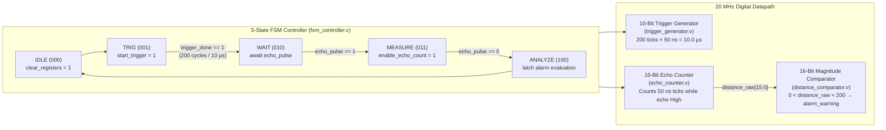

# Ultrasonic Parking Sensor ASIC (`parking_sensor_top`)

**Deterministic 20 MHz Digital Time-of-Flight Controller · RTL-to-GDSII Implementation on SkyWater 130nm (`sky130_fd_sc_hd`)**

[](https://tarunkumarkv.github.io/#floorplan)
[-1E293B?style=flat-square)](https://github.com/google/skywater-pdk)
[](https://github.com/efabless/openlane2)
[]()

---

## Overview

This repository contains the complete Verilog-2001 RTL design, unit and system-level verification testbenches, timing constraints (`.sdc`), and post-layout physical implementation artifacts (`.gds`, `.def`, `.lef`, gate-level `.nl.v`, and multi-corner STA signoff metrics) for an **Application-Specific Integrated Circuit (ASIC)** controlling an HC-SR04 ultrasonic time-of-flight transducer.

Operating at a **20 MHz system clock (`50.0 ns` period)**, the core replaces nondeterministic microcontroller software polling loops with a cycle-accurate hardware Finite State Machine (FSM) and dedicated counter/comparator datapaths, consuming **`66.77 µW`** total power across a **`0.00659 mm²` (`6,591.53 µm²`)** die footprint in the **SkyWater 130nm (`sky130_fd_sc_hd`)** technology node.

> **Interactive Silicon Explorer:** Inspect the macro placement and step through the 20 MHz cycle-by-cycle timing waveform interactively at **[tarunkumarkv.github.io/#floorplan](https://tarunkumarkv.github.io/#floorplan)**.

---

## System Architecture & Finite State Machine

The controller coordinates four modular hardware blocks under a 5-state synchronous Moore/Mealy control unit (`fsm_controller`):



### Module Specification

| Module | File | State / Width | Functional Responsibility |
| :--- | :--- | :--- | :--- |
| **`parking_sensor_top`** | [`rtl/parking_sensor_full.v`](rtl/parking_sensor_full.v) | Top-Level | Structural interconnect binding the FSM controller, 10-bit trigger generator, 16-bit echo counter, and combinational magnitude comparator. |
| **`fsm_controller`** | [`rtl/fsm_controller.v`](rtl/fsm_controller.v) | 3-bit (`5` states) | Sequentially transitions across `IDLE (3'b000)`, `TRIG (3'b001)`, `WAIT (3'b010)`, `MEASURE (3'b011)`, and `ANALYZE (3'b100)`. |
| **`trigger_generator`** | [`rtl/trigger_generator.v`](rtl/trigger_generator.v) | 10-bit (`reg [9:0]`) | Holds `trigger_pulse` high for exactly `200` clock cycles (`10.0 µs` at `20 MHz`), then asserts `trigger_done`. |
| **`echo_counter`** | [`rtl/echo_counter.v`](rtl/echo_counter.v) | 16-bit (`reg [15:0]`) | Increments `distance_raw` on every `posedge clk` while `enable_count && echo_pulse` are asserted. |
| **`distance_comparator`** | [`rtl/distance_comparator.v`](rtl/distance_comparator.v) | 16-bit Combinational | Evaluates `0 < distance_value < 16'd200` and asserts `alarm_active` (`alarm_warning`) in real time. |

---

## Post-Layout Physical & Signoff Metrics (`OpenLane 2 / Sky130`)

All physical implementation and multi-corner Static Timing Analysis (STA) numbers below are extracted directly from [`reports/metrics.json`](reports/metrics.json) and [`reports/sdc/parking_sensor_top.sdc`](reports/sdc/parking_sensor_top.sdc).

### 1. Area, Cell Breakdown & Routing Summary

| Metric | Value | Unit / Detail |
| :--- | :--- | :--- |
| **Technology & Standard Cell Library** | `sky130_fd_sc_hd` | SkyWater 130nm High-Density CMOS |
| **System Clock Frequency / Period** | `20.0 MHz` | `50.0 ns` period (`10.0 ns` I/O delay, `0.25 ns` uncertainty) |
| **Total Die Area** | `6,591.53` | `µm²` (`0.006591 mm²`) |
| **Core Area** | `4,057.64` | `µm²` |
| **Standard Cell Area / Core Utilization** | `2,209.62` | `µm²` (**`54.46%`** core utilization) |
| **Mapped Standard Cells (`stdcell`)** | `246` | `31` sequential DFFs · `108` multi-input comb · `7` CTS clock buffers · `1` clock inv |
| **Physical Well-Tap & Decap/Fill Cells** | `333` | `50` tap cells · `283` fill cells |
| **Final Routed Wirelength** | `4,039` | `µm` (TritonRoute DRC convergence: `107 → 9 → 12 → 0` in 4 iterations) |
| **Physical & Electrical Signoff** | **CLEAN (`0` Errors)** | `0` Magic DRC · `0` KLayout DRC · `0` Netgen LVS · `0` Antenna · `0` Inferred Latches |

### 2. Multi-Corner Static Timing Analysis (STA across 9 PVT Corners)

| PVT Corner | Setup WNS (I/O) | Setup WNS (Reg-to-Reg) | Hold WNS | Worst Clock Skew | Slew / Cap / Fanout Vio |
| :--- | :--- | :--- | :--- | :--- | :--- |
| **`nom_tt_025C_1v80`** *(Typical, 25°C, 1.80V)* | `+37.68 ns` | `+47.31 ns` | `+0.332 ns` | `0.256 ns` | `0 / 0 / 0` |
| **`nom_ss_100C_1v60`** *(Slow-Slow, 100°C, 1.60V)* | `+35.40 ns` | `+44.66 ns` | `+0.902 ns` | `0.260 ns` | `0 / 0 / 0` |
| **`nom_ff_n40C_1v95`** *(Fast-Fast, -40°C, 1.95V)* | `+38.47 ns` | `+48.22 ns` | `+0.116 ns` | `0.255 ns` | `0 / 0 / 0` |
| **`max_ss_100C_1v60`** *(Worst-Case Setup)* | **`+35.37 ns`** | **`+44.63 ns`** | `+0.913 ns` | `0.261 ns` | `0 / 0 / 0` |
| **`min_ff_n40C_1v95`** *(Worst-Case Hold)* | `+38.48 ns` | `+48.23 ns` | **`+0.114 ns`** | `0.255 ns` | `0 / 0 / 0` |

### 3. Power & IR Drop Analysis (`nom_tt_025C_1v80`)

| Component | Value | Share / Note |
| :--- | :--- | :--- |
| **Internal Cell Power** | `53.40 µW` | `79.98%` of total power |
| **Switching Net Power** | `13.36 µW` | `20.01%` of total power |
| **Subthreshold / Gate Leakage Power** | `2.98 nW` | `< 0.01%` (`2.98 × 10⁻⁹ W`) |
| **Total Core Power** | **`66.77 µW`** | Ultra-low power @ `20 MHz` |
| **Power Grid (`VPWR` / `VGND`) Worst IR Drop** | `19.67 µV` / `15.39 µV` | `1.79998 V` worst-case `VPWR` rail (`0` PDN violations) |

---

## Functional Verification Suite (`iverilog` + `GTKWave`)

Every submodule has an isolated unit testbench in [`dv/`](dv/) alongside the top-level full-system testbench [`dv/tb_parking_system.v`](dv/tb_parking_system.v).

### Run All Simulations via `Makefile`

```bash
# Run all 4 unit testbenches + top-level system simulation
make sim

# Run only top-level system testbench and open VCD waveform
make top
gtkwave full_system.vcd

# Clean generated binaries and .vcd dumps
make clean
```

---

## Repository Structure

```text
Ultrasonic-Parking-Sensor-ASIC/
├── Makefile                                      # One-command iverilog regression suite
├── README.md                                     # Architectural & post-layout signoff documentation
├── rtl/                                          # Synthesizable Verilog-2001 RTL
│   ├── parking_sensor_full.v                     # Top-level structural module (parking_sensor_top)
│   ├── fsm_controller.v                          # 5-state control FSM (IDLE/TRIG/WAIT/MEASURE/ANALYZE)
│   ├── trigger_generator.v                       # 10-bit 10 µs trigger pulse counter
│   ├── echo_counter.v                            # 16-bit time-of-flight echo counter
│   └── distance_comparator.v                     # Combinational safety threshold comparator
├── dv/                                           # Design Verification testbenches
│   ├── tb_parking_system.v                       # Full-system end-to-end testbench
│   ├── tb_fsm_controller.v                       # Unit testbench: FSM state transitions
│   ├── tb_trigger_generator.v                    # Unit testbench: 200-cycle trigger pulse
│   ├── tb_echo_counter.v                         # Unit testbench: 16-bit echo accumulation
│   └── tb_distance_comparator.v                  # Unit testbench: boundary distance checks
├── physical_design/                              # OpenLane 2 SkyWater 130nm physical outputs
│   ├── gds/parking_sensor_top.gds                # Final stream-out GDSII layout (Magic)
│   ├── klayout_gds/parking_sensor_top.klayout.gds# KLayout stream-out GDSII layout
│   ├── def/parking_sensor_top.def                # Routed Design Exchange Format (DEF)
│   ├── lef/parking_sensor_top.lef                # Macro Library Exchange Format (LEF)
│   └── nl/parking_sensor_top.nl.v                # Post-layout gate-level Verilog netlist
└── reports/                                      # Signoff STA, power, area & constraint artifacts
    ├── metrics.json                              # Full OpenLane 2 9-corner STA & DRC/LVS signoff metrics
    ├── metrics.csv                               # Tabular signoff metrics export
    └── sdc/parking_sensor_top.sdc                # Synopsys Design Constraints (50 ns / 20 MHz clock)
```
